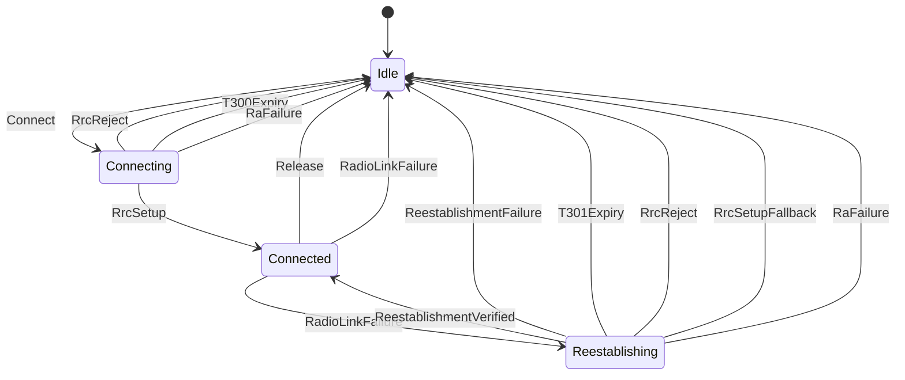
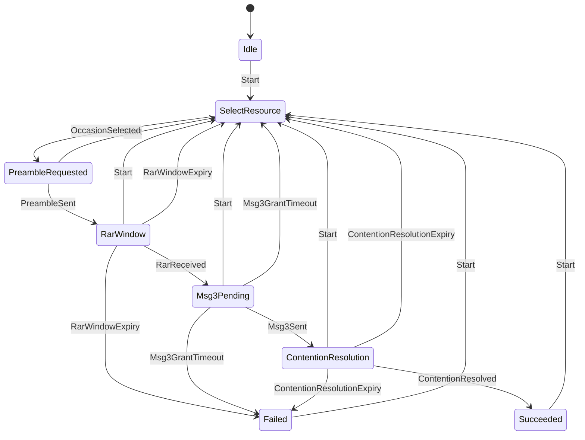

# Ferrite UE — architecture

Ferrite is a clean-room 5G NR standalone UE written in Rust from the 3GPP
specifications. This document is the design contract for the code base: what
each crate owns, the interfaces between layers, and the state machine each
layer runs. It is deliberately independent of any one cell configuration —
every cell-specific number (numerology, bandwidth, duplex mode, PRACH format,
CORESET geometry, k1/k2, PUCCH resources, …) is **derived at run time** from the
MIB, SIB1 and the dedicated RRC configuration, never transcribed. Nothing above
`ferrite-radio` knows which transport (ZMQ, file, SDR) carries the samples.

```
 ┌──────────────────────────────────────────────────────────────────────────────┐
 │ ferrite-ue   binary: config, engine wiring, stack glue (bearers, user plane) │
 ├────────────────┬───────────────┬──────────────────┬──────────────────────────┤
 │ ferrite-nas    │ ferrite-rrc   │ ferrite-pdcp     │ ferrite-rlc              │
 │ 5GMM/5GSM SM   │ RRC SM + cfg  │ SRB/DRB PDCP     │ TM/UM/AM entities        │
 ├────────────────┴───────────────┼──────────────────┴──────────────────────────┤
 │ ferrite-mac  RA, HARQ, BSR/SR, │ ferrite-security  NIA/NEA, TS 33.501 KDF,   │
 │  LCP, TA, PHR, mux/demux       │                   MILENAGE (one copy)        │
 ├────────────────────────────────┴─────────────────────────────────────────────┤
 │ ferrite-fapi   PHY ↔ MAC messages + PhyConfig (plain data, no DSP)           │
 ├──────────────────────────────────────────────────────────────────────────────┤
 │ ferrite-l1     slot engine: sync, PDCCH monitoring, PDSCH/HARQ rx,           │
 │                PRACH/PUSCH/PUCCH/SRS tx, UL timing, DCI → grant resolution   │
 ├──────────────────────────────┬───────────────────────────────────────────────┤
 │ ferrite-phy  DSP: OFDM, sync,│ ferrite-radio  ZMQ / file / SDR IQ transports │
 │  coding, channels, PRACH     │                (SampleSource / SampleSink)    │
 ├──────────────────────────────┴───────────────────────────────────────────────┤
 │ ferrite-ran  TS 38.21x tables & arithmetic: MCS, TBS, DM-RS positions, PRACH │
 │              configuration, RIV, default TDRA, SRS bandwidth (no DSP)        │
 ├──────────────────────────────────────────────────────────────────────────────┤
 │ ferrite-asn1  UPER codec + TS 38.331 message coders        ferrite-common    │
 └──────────────────────────────────────────────────────────────────────────────┘
```

Crate dependencies (Cargo):

| crate | depends on |
|---|---|
| `ferrite-ran` | common |
| `ferrite-fapi` | common, ran |
| `ferrite-phy` | common, ran (+ radio for tests) |
| `ferrite-l1` | common, fapi, phy, radio |
| `ferrite-mac` | common, fapi, ran |
| `ferrite-security` | — (RustCrypto) |
| `ferrite-pdcp`, `ferrite-rlc` | common (+ security for PDCP) |
| `ferrite-rrc` | common, asn1, fapi, ran, mac (MacConfig), security |
| `ferrite-nas` | common, security |
| `ferrite-ue` | everything |

MAC and RRC never link the DSP crate: everything they need about grants and
configuration is plain data in `ferrite-fapi`, and the few spec tables they
compute with (PRACH occasions, TBS) come from `ferrite-ran`. Dependency
direction is strictly downward; every cross-layer interaction is a message or
a trait call on a service-access point defined by the lower layer.

## 1. Vocabulary (ferrite-common)

* `Iq` (complex f32), `Error`/`Result`.
* `Numerology { mu }` and `SlotPoint { mu, sfn, slot }`: the slot clock shared
  by every layer (`add`, `diff`, absolute index arithmetic mod 1024 frames).
* `Rnti` newtype, `RntiKind { Si, P, Ra, Tc, C }`.
* `DuplexMode`, band table subset with ARFCN ↔ Hz / GSCN ↔ Hz.

## 2. Spec tables (ferrite-ran) and DSP (ferrite-phy)

`ferrite-ran` is pure arithmetic over plain data (TS 38.211–38.214 tables):
`mcs` (tables 1/2/3 and 6.1.4.1-1), `tbs` (§5.1.3.2), `dmrs` (DM-RS symbol
positions, antenna-port tables), `prach_config` (configuration tables FR1
FDD/TDD, occasion enumeration), `riv`, `tdra` (default tables), `srs`
(bandwidth table, layout). `ferrite-phy` re-exports them under its old paths.

`ferrite-phy` is signal processing: pure functions over slices, no I/O, no cell
state beyond the arguments, generalised over `mu ∈ {0,1}` and any `fs`.

| module | content | spec |
|---|---|---|
| `numerology`, `ofdm` | CP lengths, (de)modulator, `PhaseCompensation` (§5.4 per-symbol carrier phase, applied on UL, undone on DL) | 38.211 §4, §5.3, §5.4 |
| `sync::*` | PSS/SSS, SSB cases A/B/C, PBCH + MIB, CFO, SS-RSRP/RSRQ/SINR | 38.211 §7.4.3, 38.213 §4.1, 38.215 |
| `coreset0` | Tables 13-1…13-6, 13-11 | 38.213 §13 |
| `pdcch` | CORESET geometry, candidate hashing, DM-RS, equalisation, coherence gate | 38.211 §7.3.2, 38.213 §10.1 |
| `coding::dci` | polar DCI, field layouts and sizes for 0_0/1_0/0_1/1_1 from the RRC configuration | 38.212 §7.3.1 |
| `coding::{crc,polar,ldpc,ratematch,dlsch}` | channel coding (structured LDPC encoder, AVX2 decoder) | 38.212 §5 |
| `pdsch` | RE extraction in §7.3.1.5 order, VRB→PRB, rate matching around CSI-RS, demapping | 38.211 §7.3.1, 38.214 §5.1 |
| `pusch` | CP-OFDM and DFT-s-OFDM PUSCH (transform precoding, low-PAPR DM-RS, π/2-BPSK), UCI multiplexing (`uci_pusch_layout`: HARQ-ACK / CSI part 1 counts and RE map as OCUDU's demultiplexer reads them) | 38.211 §6.3.1, 38.212 §6.2.7, §6.3.2.4 |
| `pucch` | formats 0, 1, 2, 3 | 38.211 §6.3.2 |
| `prach` | preamble formats 0–3 and A1–C2, waveform at any `fs` | 38.211 §6.3.3 |
| `srs` | low-PAPR sequences, SRS modulation | 38.211 §6.4.1.4 |
| `csi` | NZP-CSI-RS sequence, rows 1/2/3/4 RE patterns, SINR / CQI, two-port rank + PMI selection on the Type I codebook | 38.211 §7.4.1.5, 38.214 §5.2 |

## 3. Radio transport (ferrite-radio)

`SampleSource` / `SampleSink` traits; backends: ZMQ (gNB-compatible REQ/REP
lockstep), file, SDR (SoapySDR through the `soapysdr` crate, feature-gated).
Time above this crate is counted in samples: a backend with a device time base
reports the sample index of every delivered buffer (`SampleSource::timestamp`)
and takes timed bursts by sample index (`SampleSink::write_at`); the SoapySDR
backend converts to the library's nanoseconds once per buffer with SoapySDR's
own algorithm and the rate its timestamps actually advance at (measured at open
time: the LimeSuiteNG module converts with the requested rate while reporting
the achieved one), and checks that the conversion is the identity. Both chains
are set up before either is activated and torn down together (modules with one
shared stream object need both). `time::Contiguous` pins a timestamped source
to a gap-free index: stream sample `i` is device sample `origin + i`, lost
samples (overflows) come out as zeros, and the shared `TimeBase` publishes the
origin and the receive head to the transmit side. The L1 engine only sees
sample indices; the pacing policy (`UlPacing`) is selected by the backend.

`channel` is a test aid, not a backend: a multipath fading channel
(`Link`) for the `ferrite-chanem` ZMQ proxy (TEST_PLAN §5.2). Per block it
resamples (windowed-sinc, 1024 phases; the sample-clock error), filters with
a per-antenna-pair FIR rebuilt every 64 samples from the faded TDL taps, mixes
the carrier offset and adds noise. The proxy pulls each direction's upstream
blocks in a fetcher thread, keeps the antenna ports sample-aligned when the
transmitter's replies differ in length (carry-over buffers), and answers each
downstream port from its own thread, so a reader that drains one port before
the next never stalls the others.

## 4. L1 — the slot engine (ferrite-l1)

`ferrite-l1` turns a sample stream into slot-synchronous FAPI messages for MAC
and turns MAC transmit requests into samples at the right absolute position.
It is the only crate that knows about sample indices.

### 4.1 Threads

```
 radio-rx thread ─▶ BufferedStream ─▶ timeline thread (T0) ─▶ PDSCH worker
                                            │  ▲                   │
                                            ▼  └── RX_Data ◀───────┘
                                   MAC/RLC/PDCP/RRC/NAS (synchronous on T0)
                                            │ UL_TTI.request
                                            ▼
                                       tx-build thread ─▶ InjectionTable ─▶ UL serve thread
```

T0 owns the slot clock: per DL slot it reads the samples, tracks timing/CFO
(§4.2b), runs the PDCCH monitor, hands PDSCH jobs to the worker, waits for the
worker's results of earlier slots, then delivers `SLOT.indication` and applies
the MAC's requests.

### 4.2 Timing model

`ul_index(slot) = dl_index(slot) − (N_TA + N_TA_offset)·T_c·fs` (38.211
§4.3.1) plus the *uplink guard* (default 1 µs, applied to every UL channel; the
TA command measures and cancels it). The PRACH is transmitted with `N_TA = 0`
(`SampleClock::with_n_ta(0)`). Lockstep transports are served up to a *commit
mark* (`ul_index(n + tx_lead + 1)` after slot `n`), never a heuristic "k slots
behind". A free-running SDR is gated by the same mark (a block is written only
once its uplink is final) but not paced: `TimedPushUlSink` stamps every block
with its air time `origin + ul_index` in the device clock shared with the
receive side, and skips (counts, logs) a block whose air time is nearer than the
device's write-to-air latency budget (`--sdr-tx-latency-us`) instead of handing
it over late. The RX→TX chain latency of a device is `--tx-rx-offset`,
measured with the `tx_rx_cal` example (loopback burst).

### 4.2b Synchronisation tracking (`track`)

`SyncTracker` owns the CFO estimate and every move of the sample clock's
anchor. It is fed, relative to what the anchor predicts:

* at every SSB, the integer PSS position plus the fractional delay from the
  SSS phase slope (`SsbMeasurement::delay_samples`), and the CP-correlation
  CFO residual;
* for every PDSCH that passes its CRC, the delay from the DM-RS phase rotation
  four subcarriers apart (`pdsch::dmrs_delay`, unaffected by a second port in
  the CDM group or a PRB-wise precoder) and the residual CFO from the rotation
  between DM-RS symbols (`PdschLlrs::cfo_slope`).

Each measurement carries a `SyncTag` (DL index, anchor steps applied so far,
CFO removed from those samples), so results from the worker that arrive after
a step are referred to the current anchor. Timing is a critically damped
second-order loop (offset and drift, 0.5 Hz natural frequency) whose gains
scale with the time between measurements, so the bandwidth does not depend on
the scheduling; the CFO is a first-order filter (100 ms). When LO and sample
clock share a reference (`--independent-lo` says otherwise), the drift is fed
forward as `−CFO/f_c · f_s` samples per second, and the loop's own rate state
only takes the remainder. `advance()` integrates the drift once per slot and
hands out one-sample anchor steps when the modelled offset passes ¾ of a
sample; errors beyond 3 samples (a gap, a transport jump) are taken at once.
Downlink and uplink follow the same anchor, so the transmit timing drifts with
the downlink in small steps. Every 10.24 s the engine logs a `tracking:` line
with CFO, drift (ppm), offset and step counts. Over ZMQ every measurement is
zero and no step is taken.

### 4.2a Receive gain (`agc`)

When the front end has a gain (`ferrite_radio::GainControl`, attached to the
`DlStream`), the engine runs an AGC on downlink power only: every cell-search
capture and every SSB slot (a downlink slot by definition; over TDD the uplink
slots carry the UE's own leakage). It aims the mean slot power at −22 dBFS
(OFDM peaks sit 10–12 dB higher), moves in whole dB outside a ±3 dB band, holds
200 slots after a change so the tracking loops settle, and learns the device's
real limits from what it applies (the XTRX advertises 49 dB and stops at 48).
Every SSB measurement carries the gain in force, and the stack converts
`dBm = dBFS − gain + rx_power_offset_db` (the dBm of full scale at 0 dB gain,
a device constant; 0 over ZMQ).

### 4.3 L1 state

```
 CellSearch ──SSB + MIB──▶ Synced { phase: AwaitSib1 } ──CONFIG.request (SIB1)──▶ { phase: Common }
     ▲                           │                                               │ CONFIG.request (dedicated)
     │ PSS missed for             │                                               ▼
     │ RLM_MAX_MISSED_SSB periods ◀──────────────────────────────────── { phase: Dedicated }
```

`CellPhase` is set by every `CONFIG.request` (dedicated when a UE-specific
search space or PUCCH resource is configured). Orthogonal to it: `tx_enabled`
(`START` / `STOP.request`; a `STOP` makes every UL_TTI request an
`ERROR.indication TxDropped`), the uplink timing (`SampleClock`, N_TA from
MAC) and the HARQ soft buffers of the PDSCH worker (one per `(RntiKind,
process)`, reset when the NDI toggles or the TB size changes).

The TDD pattern is a scheduling input: `DciResolver` drops a PDSCH that
would lie in UL symbols and a PUSCH (DCI 0_0/0_1, RAR grant) in DL symbols
(`PhyConfig::dl_allowed` / `ul_allowed`, TS 38.213 §11.1; flexible symbols are
allowed), and `PrachConfig::occasions_in_slot` keeps only the occasions valid
under TS 38.211 §6.3.3.2 (UL symbols, or flexible symbols after the slot's
SS/PBCH blocks plus `N_gap`; the transmitted SSBs come from SIB1 through
`ferrite_ran::ssb`). A DCI 1_1 / 0_1 whose bandwidth-part indicator names
another BWP resolves to `Dci::BwpSwitch` (TS 38.212 Table 7.3.1.1.2-1 value →
BWP-Id); the grant it carries is not resolved, so the gNB's first
transmission on the new BWP is lost and retransmitted — a known simplification.

Receive antennas: `radio::DlStream` holds one `BufferedStream` per antenna
and reads them in lockstep (same sample index everywhere); cell search and
the SSB tracking read antenna 0, the slot loop reads all antennas and hands
`Arc<Vec<Vec<Iq>>>` (per antenna) to the PDSCH worker, which demodulates every
antenna. The PDCCH monitor uses antenna 0. PDSCH: the 1x1 case keeps the
single-port extractor; with several antennas or two layers
`pdsch::extract_pdsch_mimo` estimates the channel of every (antenna, DM-RS
port) from the type-1 DM-RS (ports 0/1 of a CDM group separated by the
frequency OCC over each RE pair, TS 38.211 §7.4.1.1.2), averages the
de-rotated per-symbol estimates per RB, takes the noise variance from the
spread of the pair estimates and equalises every data RE with a regularised
zero-forcing combiner (MRC for one layer); the LLRs come out in codeword
order (layer 0 then layer 1 per RE, §7.3.1.3) and the TBS/rate matching use
`n_layers`. DCI 1_1 antenna-port values with one or two DM-RS ports are
resolved (`DlGrant::{n_layers, dmrs_ports}`); three and four layers are
dropped. The CSI report goes out in the TS 38.212 Table 6.3.1.1.2-7 layout
(`RI | padding | PMI | CQI`, sized from the codebook's ports and the
`ri-Restriction` whose bit `i` (LSB = rank 1) allows rank `i + 1`). The
rank and PMI come from the two-port NZP-CSI-RS (Table 7.4.1.5.3-1 row 3: one
FD-CDM2 group on subcarriers `k0, k0+1`, sequence index `2n + k'`):
`csi::measure_csi_rs_ports` despreads the two ports on every receive
antenna per RB, takes the noise from the RB-to-RB spread of the estimates,
and picks the rank and `i2` of the two-port Type I single-panel codebook
(TS 38.214 Table 5.2.2.2.1-1: rank 1 `[1, φ_n]/√2`, rank 2
`[[1, 1], [φ_n, −φ_n]]/2`, `φ_n = e^{jπn/2}`) that maximise the sum of the
per-layer `log2(1 + SINR)` (MRC gain for rank 1, post-MMSE SINRs for rank
2); the CQI maps the mean post-equalisation SINR. The engine queues a CSI
measurement on every occasion of a measured resource (the single-port TRS
and every two-port resource); the MAC keeps the rank / PMI of the latest
multi-port measurement and lets a single-port one refresh only the CQI
(`CsiIndication::nof_ports`).

Radio link monitoring (TS 38.133 §8.1) runs once per SSB period on the
serving SSB: `rlm_evaluate` turns the SSB SINR into `SYNC.indication
in_sync = false` below Q_out (−8 dB, or SSB not found) and `in_sync = true`
above Q_in (−6 dB), nothing in between. The indication goes to MAC, which hands
it to RRC unchanged; RRC runs N310 / T310 / N311 with the cell's values. The
engine's own `RlmState` is separate: after `RLM_MAX_MISSED_SSB` (250) periods
without the PSS the slot timing cannot be trusted any more and it re-searches
and rebuilds `Synced` from the MIB (MAC receives `ErrorIndication::SyncLost`;
RRC must send a new `CONFIG.request` and MAC new RNTIs once the cell is found
again). That limit is above the largest T310 so that RRC declares the failure
first. `EngineParams::rlm_outage` (`--rlm-outage-s/-ms`) forces out-of-sync for
a test window without touching the data path.

## 5. FAPI: the PHY ↔ MAC interface (ferrite-fapi)

Modelled on the SCF-222 5G FAPI PHY API, adapted to the UE direction. The
crate holds plain data only: the messages and `config::PhyConfig` (the
CONFIG.request payload RRC derives from MIB/SIB1/CellGroupConfig).

```rust
enum PhyToMac { Slot(SlotIndication), Dci(DciIndication), RxData(RxDataIndication),
                Csi(CsiIndication), Rach(RachIndication), Sync(SyncIndication),
                Error(ErrorIndication) }
enum MacToPhy { Config(Box<PhyConfig>), Start, Stop, UlTti(UlTtiRequest),
                SetRntis { c_rnti, tc_rnti, ra_rnti }, TimingAdvance { n_ta_tc },
                Paging { ue_id }, PdcchMonitoring { c_rnti: bool },
                RarGrant { rar_slot, tc_rnti, grant: RarUlGrant } }
enum UlTtiPdu { Prach { occasion, preamble, power_offset_db },
                Pusch { grant: UlGrant, tb, uci }, Pucch { resource, uci }, Srs { resource_id } }
trait MacHandler { fn handle(&mut self, msg: PhyToMac, phy: &mut dyn MacToPhySink); }
```

The PHY owns the configuration, so it **resolves** every grant: the `Dci`
indication carries `DlGrant` / `UlGrant` (PRBs, symbols, MCS, TBS, HARQ id,
NDI, RV, timing, PUCCH indicator, DAI, DM-RS and transform-precoding
parameters), never DCI bit fields. The RAR UL grant follows the same rule: MAC
parses the RAR MAC PDU and sends `RarGrant`; the PHY answers with a TC-RNTI
`UlGrant` for `rar_slot + k2 + Δ` (TS 38.213 §8.2/8.3) that MAC turns into
Msg3 like any other PUSCH. Common search spaces are decoded before UE-specific
ones and a payload already decoded for an RNTI in a slot is not decoded again
(phantom grants through overlapping candidates). `Paging { ue_id }` turns on
P-RNTI decoding in the UE's paging frames (TS 38.304 §7.1).

## 6. MAC (ferrite-mac)

`MacEntity::handle_with(msg, phy, upper)` is the FAPI entry; `UpperLayers`
(`dl_sdu`, `ul_pull`, `ul_buffer_status`) is the SAP the bearer table
implements; RRC drives it with `reconfigure`, `start_ra`, `reset` and reads
`take_events()` (`MacEvent`: `RaSucceeded`, `RaFailed`, `Bcch`, `Pcch`, `Ccch`,
`SrFailure`, `TimeAlignmentExpired`, `RadioLinkFailure`, `Sync`). Fields are private;
`ra_state()`, `ta_state()`, `sr_states()`, `c_rnti()`, `stats()` are read-only
views. Sub-procedures and their states:

* **Random access** (§5.1), `RaState`:
  `Idle → SelectResource → PreambleRequested → RarWindow → Msg3Pending →
  ContentionResolution → Succeeded | Failed`, with backoff and power ramping on
  every retry (window / timer expiry) until `preambleTransMax`. `Msg3Pending`
  is the wait for the PHY's resolution of the RAR grant.
* **Scheduling request** (§5.4.4), `SrState`: `Idle → Pending { counter,
  prohibit } → Idle` (a BSR went out) or `→ Failed` (sr-TransMax: the entity
  starts a C-RNTI random access and reports `SrFailure`). An SR configuration
  is triggered only by logical channels mapped to it (`schedulingRequestID`).
* **Timing advance** (§5.2), `TaState`: `NotAligned → Aligned { expiry }` on
  the RAR / every TA Command CE; on `timeAlignmentTimer` expiry the HARQ
  buffers are flushed, no uplink but PRACH is transmitted and RRC is told.
* **HARQ**: DL per process `ndi` / `delivered` (duplicates of a delivered TB
  are dropped); UL per process the stored TB for retransmissions at the
  signalled RV; the HARQ-ACK codebook (dynamic, §9.1.3) is booked per slot.
* **DRX** (§5.7), `DrxState`: `Off → Long ⇄ Short { until }`. `drx.rs` runs
  drx-onDurationTimer (from `[(SFN×10)+subframe] mod cycle = offset`, plus
  `drx-SlotOffset`), drx-InactivityTimer (restarted by every C-RNTI PDCCH:
  the spec says new transmissions only, but OCUDU extends the Active Time on
  retransmission grants too and staying awake longer never loses data),
  per-HARQ-process RTT → retransmission timers (DL only for a TB that
  was not decoded) and the short-cycle timer; the DRX / Long DRX Command CEs
  end the on-duration. Active Time also covers a running random access and a
  pending SR. Each slot the entity tells the PHY `PdcchMonitoring { c_rnti }`
  on a change, so C-RNTI candidates are not searched while asleep; periodic
  CSI is skipped outside Active Time, HARQ-ACKs are always sent, and the
  periodic SRS keeps going by default (`MacConfig::srs_outside_active_time`:
  OCUDU derives the timing advance from every SRS occasion, empty ones
  included, and walks the uplink out of the cyclic prefix otherwise).
* **Bandwidth parts** (§5.15): `MacConfig::{dl_bwp_id, default_dl_bwp_id,
  bwp_inactivity_timer_ms}`. The bwp-InactivityTimer runs on a non-default
  BWP, restarts on every C-RNTI PDCCH, is stopped by a random access and
  switches back to the default BWP on expiry; a `Dci::BwpSwitch` and a random
  access from a non-initial BWP (only the initial UL BWP has PRACH) also
  request a switch. Every switch is a `MacEvent::BwpSwitch` that RRC answers
  with the BWP's configuration (`Reconfigure` → CONFIG.request).
* **BSR** (§5.4.5, regular/periodic/padding, short/long), **LCP** (§5.4.3.1),
  **PHR** (§5.4.6, Single Entry PHR, Type 1 from the power-control state),
  **SRS** occasions (dropped when a PUCCH/PUSCH goes out in the slot).
* **Uplink power control** (TS 38.213 §7, `power.rs`, `UlPowerControl`): the
  pathloss is `ss-PBCH-BlockPower − filtered SS-RSRP (dBm)`; PRACH =
  target + ramp + PL; PUSCH = `P_O + 10·log10(2^µ·M_RB) + α·PL + f(i)` with
  `f(0) = ΔP_rampup + δ_msg2` from the RAR and the UL-DCI TPC accumulated (or
  absolute); PUCCH adds `Δ_F`, `Δ_TF` (formats 0/1 by symbols, 2–4 by UCI bits
  per RE) and `g(i)` from the DL-DCI TPC; SRS rides the PUSCH loop; all capped
  at `P_CMAX = min(p-Max, device full scale − 12 dB)`. Every UL_TTI PDU carries
  `power_dbm`; the L1 sets the RMS level against the transmitter calibration
  (`PhyConfig::tx_full_scale_dbm`, from `--tx-power-offset-db`) and adds the
  format's `Δ_PREAMBLE` to the PRACH. Without a calibration (ZMQ) powers are
  `None` and waveforms are peak-normalised as before.
* DL MAC PDU parsing follows TS 38.321 Table 6.2.1-1 (fixed-size CEs, SDUs
  with L fields; eLCID / reserved LCIDs stop the parse).

## 7. RLC (ferrite-rlc) and PDCP (ferrite-pdcp)

`RlcEntity::new(RlcMode::{Tm, Um(UmConfig), Am(AmConfig)}, numerology)` with
`tx_sdu`, `rx_pdu`, `pull_pdu(max_bytes, now)`, `pop_rx_sdu`, `tick`,
`events()` (`MaxRetxReached`). AM: full window, segmentation and
re-segmentation, STATUS with NACK ranges, polling, t-Reassembly /
t-PollRetransmit / t-StatusProhibit. UM: per-SN reassembly with t-Reassembly.

`PdcpEntity` (38.323): SN 12/18, `tx_sdu`, `rx_pdu`, `pop_rx_sdu`, `tick`,
reordering, HFN inference, `configure_security(SecurityConfig)` with the typed
`IntegrityAlg` / `CipherAlg` of `ferrite-security` (NIA1/NIA3/NEA1/NEA3 are
rejected, never silently passed through), `verify_only(pdu, alg, key)` for the
SecurityModeCommand / RRCReestablishment MAC-I checks, `reestablish()`.

## 8. Security (ferrite-security)

One implementation of 128-NIA2 (AES-CMAC), 128-NEA2 (AES-CTR), the null
algorithms, the TS 33.501 Annex A key hierarchy (RES*, K_AUSF, K_SEAF, K_AMF,
K_gNB, the NAS/RRC/UP algorithm keys with their type distinguishers 0x01–0x06,
the horizontal K_NG-RAN*) and MILENAGE. `IntegrityAlg` / `CipherAlg` carry the
identifier and `is_supported()`; the NAS capability advertises exactly the
supported set (EA0/EA2, IA0/IA2).

## 9. RRC (ferrite-rrc)

`RrcUe` keeps `RrcState` (TS 38.331 §4.2.1 plus the two procedure sub-states;
every transition goes through `set_state`, which logs it):

```
 Idle ──connect / connect_for (RRCSetupRequest, T300)──▶ Connecting ──RRCSetup──▶ Connected
 Connecting ──T300 / RRCReject / RA failure──▶ Idle
 Connected ──RRCRelease──▶ Idle          Connected ──RLF, AS security active (T301)──▶ Reestablishing
 Connected ──RLF without security──▶ Idle   Reestablishing ──RRCReestablishment verified──▶ Connected
 Reestablishing ──T301 / RRCReject / RRCSetup fallback / RA failure──▶ Idle
```

Radio link failure (§5.3.10.3) comes from `MacNotification`: T310 expiry
(`SyncIndication`s from the PHY: N310 consecutive out-of-sync start T310, N311
consecutive in-sync stop it; T310/N310/N311 from SIB1 `ue-TimersAndConstants`,
only counted while `Connected`), `RaFailed` while connected, `RlcMaxRetx`, and
`RadioLinkFailure` (the PHY gave the cell up). T311 is trivially satisfied
today: the UE re-selects the serving cell at once. Bandwidth parts: every
`CellGroupConfig` is applied per configured DL BWP (`codec::cell_group_bwps`
→ `apply_cell_group_bwp`: the BWP's generic parameters and common
PDCCH/PDSCH/PUSCH/PUCCH config, its dedicated part, the cell-level items),
kept in `CellInfo::bwps`; `firstActiveDownlinkBWP-Id` selects the active one
and `RrcUe::switch_bwp` (from `MacNotification::BwpSwitch`) activates another
with a `Reconfigure`. The UL BWP with the same id is paired with a DL BWP,
the initial UL BWP otherwise. OCUDU configures a single BWP, so this path has
unit tests only (`tests/codec.rs`). `RRCSetup` is
accepted only while `Connecting`; an algorithm the UE cannot run in a
SecurityModeCommand yields a SecurityModeFailure. RRC never touches the lower
layers: it emits `RrcEvent`s (`CellConfigured`, `Reconfigure`, `SetupBearer`,
`ReleaseBearer`, `StartRa`, `TxSrb`, `VerifySecurity`, `VerifyReestablishment`,
`Reestablishing`/`Reestablished`, `DlNas`, `Connected`, `Released`, `Paged`,
`Failed`) that the stack applies, and reads `MacNotification`s. Procedures:
system information (MIB/SIB1 → `PhyConfig`/`MacConfig`, SI messages), connection
establishment, security mode, UE capability (256-QAM), reconfiguration (bearer
setup with PDCP/RLC continuity, dedicated PHY/MAC as a delta, CSI-RS add/mod/
release), DL/UL information transfer, release to idle (paging with the
5G-S-TMSI, service request for data / paging), re-establishment (shortMAC-I,
horizontal K_NG-RAN*), measurements (`meas.rs`: L3 filtering, periodical and
A1/A2 reports). Configuration derivation lives in `codec.rs`
(`cell_from_sib1`, `apply_cell_group`, `bearers_of`); nothing below RRC sees
ASN.1.

## 10. NAS (ferrite-nas)

`NasUe` keeps `MmState` with the TS 24.501 §5.1.3.2 substates:
`Deregistered(DeregisteredSub)` (`NormalService`, `LimitedService`,
`AttemptingRegistration`, `PlmnSearch`, `NoSupi`, `InitialRegistrationNeeded`),
the procedure states `RegistrationInitiated → Authenticating → SecurityMode`,
`Registered(RegisteredSub)` (`NormalService`, `NonAllowedService`,
`AttemptingRegistrationUpdate`, `LimitedService`, `PlmnSearch`,
`UpdateNeeded`), `ServiceRequestInitiated` and `DeregistrationInitiated`; and
one `SmState` per PDU session (`Inactive → ActivePending → Active →
InactivePending`). Orthogonal to it, `CmState` (5GMM-IDLE / 5GMM-CONNECTED) is
set by the stack from the RRC connection: a procedure started in 5GMM-IDLE
queues its first message and emits `NasEvent::ConnectionNeeded`; the stack
establishes the RRC connection (mo-Signalling) and carries
`take_pending_initial_message()` in RRCSetupComplete, with the AS keys derived
from that message's uplink NAS COUNT.

Timers (Table 10.2.1) run on the air-interface clock the stack derives from
the slot indications: T3510 (registration), T3511 / T3502 with the
registration attempt counter (§5.5.1.2.7: five T3511 retries, then T3502),
T3512 (periodic registration update, running only in 5GMM-IDLE, §5.3.7),
T3517, T3519 (SUCI reuse), T3520, T3521, T3346 (congestion back-off from a
REJECT or DEREGISTRATION REQUEST; `barred()` holds registrations and service
requests), T3580 / T3582. 5GMM causes map to substates in `cause_outcome`
(#3/#6/#7/#27 → `NoSupi`, #11/#73/#74 → `PlmnSearch`, #12/#13/#15/#72/#75/#76
→ `LimitedService`, #22 → T3346, #9/#10 → a fresh initial registration,
others → the attempt counter). A network DEREGISTRATION REQUEST with
"re-registration required" registers again on the same connection; a
CONFIGURATION UPDATE COMMAND with "registration requested" starts a mobility
registration update when the connection is released; a TAI outside the
registration area does so immediately. NOTIFICATION is answered with the PDU
session status, PDU SESSION MODIFICATION COMMAND with a COMPLETE (the default
QoS rule stays in force). 5G-AKA with MILENAGE and SQN management, NAS
security context (NIA2 / NEA0 / NEA2), PDU session establishment (IPv4). The
NAS exchanges opaque PDUs with RRC through the stack (`NasUe::on_dl_nas` → UL
PDUs; `NasEvent`s to the stack). Every uplink message is cross-checked in the
tests with the independent `oxirush-nas` decoder (`validate()` clean).

## 11. Application (ferrite-ue)

* `stack.rs`: thin glue implementing `MacHandler`. Owns `MacEntity`, the
  bearer table, `RrcUe`, `NasUe` and the user plane; routes `MacEvent` →
  `MacNotification`, applies `RrcEvent`s, drains `NasEvent`s (after every DL
  NAS message and every NAS tick), holds the AS-security hand-over state (the
  verified `AsSecurity` and the two raw PDUs awaiting MAC-I verification), the
  connection retry policy and the uplink queue of an idle UE.
* `bearers.rs`: `Bearers` (RLC + PDCP per LCID) implementing `UpperLayers`:
  `setup(BearerSetup)` with PDCP/RLC continuity, `install_security`,
  `begin/end_reestablishment`, `deliver_rx`. The default DRB is derived from
  the table (no separate bookkeeping to go stale).
* `userplane.rs`: TUN device, or the built-in ICMP echo client / responder.
* `config.rs`, `main.rs`: CLI/TOML, engine wiring, event reporting, exit code.

## 12. What is explicitly *not* configuration-specific

* No slot-pattern constants: for FDD every slot is DL and UL; TDD gates come
  from `tdd-UL-DL-ConfigCommon`.
* No PRACH timing constants: occasions are enumerated from the configuration
  table and placed by symbol.
* No DCI size constants: sizes are computed per 38.212 from the configuration.
* No PUCCH/CSI resource constants: from `PUCCH-Config` / `CSI-MeasConfig`.
* No mapping-order / CDM / TBS sweeps: spec order, DCI antenna-port field,
  38.214 §5.1.3.2.

## 13. Declared state machines (`ferrite_common::fsm`)

A protocol state machine states its transitions as data: a `Machine` lists
its states (as a fieldless *kind* when the state carries data), its events
and a table of rules `(from, event) → to`, each with the specification
clause it implements; a deliberate deviation says `ferrite: …`. The entity
keeps its state in an `Fsm`, and `Fsm::transition` is the only way to change
it: a move the table does not allow is refused (state unchanged), counted in
`FsmStats::violations` and logged as an error. It never panics. Every
transition made is logged with its clause, e.g.
`RRC Connecting → Connected on RrcSetup [38.331 §5.3.3.4]`. Leaving a state
stops the timers that belong to it.

Checks, cheapest first:

1. `fsm::check` per machine (unit test): rules use listed kinds and events,
   no self-loops or duplicates, every rule names a clause, every event is
   used, every kind is reachable from the initial one.
2. Scenario and randomised tests drive the real entity and assert no
   violation. RRC: `random_inputs_stay_inside_the_table`, 200 seeds × 120
   inputs, every table edge exercised, T300 only in Connecting, T301 only in
   Reestablishing, T310 only in Connected.
3. Kani proofs (`#[cfg(kani)]`, `cargo kani -p <crate>`) on the real code.
   RA: `ra_step_preserves_the_invariant` is an inductive proof. From *any*
   state with any data satisfying the invariant, one arbitrary input keeps
   the invariant, causes no violation, and does not panic or overflow. The
   invariant is: counter within 1..=preambleTransMax+1; Failed exactly when
   it is preambleTransMax+1; ramping counter ≤ transmission counter. Cover
   checks show that the failure, success and RAR paths are reachable, so
   the proof is not vacuous. `ra_moves_only_along_its_table` replays every
   6-input sequence from a fresh procedure. About 30 s and 10 min.
4. Planned: a composed NAS × RRC × MAC RA model for deadlock and liveness,
   validated against the transition logs of lab runs.

The diagrams below are generated from the tables, and
`ferrite-ue/tests/fsm_docs.rs` fails when they differ.

Converted so far: RRC (`ferrite_rrc::machine`) and MAC random access
(`ferrite_mac::RaMachine`). The plan is in BACKLOG ("Architecture
improvements"): NAS MM/CM/SM, MAC SR/DRX/TA and L1 `CellPhase`/RLM next,
then the implicit machines (HARQ, RLC AM, the stack's retry and security
hand-over).

RRC (`RrcMachine`):



MAC random access (`RaMachine`):


